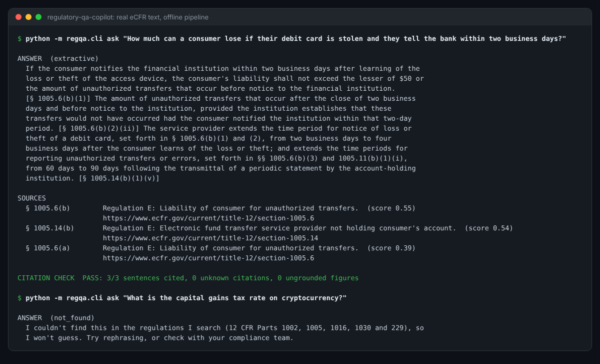
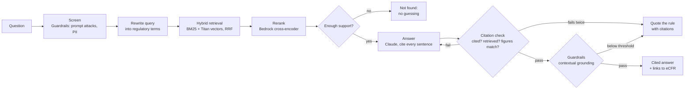

# Regulatory Q&A Copilot

[](https://github.com/athulyakollipara-web/regulatory-qa-copilot/actions/workflows/ci.yml)
 

Answers compliance questions about US consumer-banking regulations, where **every sentence cites the exact paragraph it comes from**, and **every figure is checked against the cited text**. If the regulations don't answer the question, it says so instead of guessing.

- *"How much can a customer lose if their debit card is stolen and they tell us within two business days?"*
- *"Can we charge overdraft fees on one-time debit card purchases if the customer never opted in?"*
- *"How many days do we have to notify an applicant after a credit decision?"*



The corpus is the real text of five regulations from the official [eCFR](https://www.ecfr.gov), downloaded fresh on every CI run:

| Regulation | 12 CFR Part | Covers |
|---|---|---|
| Regulation B | 1002 | Equal credit opportunity, adverse action notices |
| Regulation E | 1005 | Electronic fund transfers, debit cards, overdraft opt-in, remittances |
| Regulation P | 1016 | Privacy notices, opt-out of information sharing |
| Regulation DD | 1030 | Truth in Savings: account disclosures, overdraft fee reporting |
| Regulation CC | 229 | Funds availability, check holds, substitute checks |

## How it works



| Step | What it does | Tech |
|---|---|---|
| Corpus | Downloads the regulations as XML (gzip, which the eCFR API requires) and labels every paragraph with its full citation (`1002.9(a)(1)(iv)`): `(a)` / `(1)` / `(i)` / `(A)` nesting, headings that run into the first sub-paragraph with a dash, and the letter-vs-roman ambiguity of `(i)`, resolved by looking at the next paragraph | eCFR API, Python |
| Chunking | One chunk per top-level paragraph with its sub-paragraphs, so a whole rule stays together but each sub-paragraph stays citable | |
| Retrieval | BM25 over paragraph text, BM25 over section headings and vector search, fused with Reciprocal Rank Fusion; a small banking glossary maps everyday words ("debit card", "ATM") to regulatory terms ("access device", "electronic terminal") | Titan Text Embeddings V2 (hashing embedder offline), OpenSearch-ready |
| Reranking | A cross-encoder reads question and candidate together to order the top 5 | Bedrock Rerank (lexical reranker offline) |
| Support gate | Low relevance → "not found". The threshold is chosen by the evaluation sweep, not guessed | |
| Answer | Claude answers from numbered paragraphs only and must cite each sentence | Bedrock Converse, model routing with fallback, prompt caching |
| Citation check | Rejects uncited sentences, citations to paragraphs that weren't retrieved, and figures (`$50`, `60 days`) not present in the cited paragraph. Errors go back to the model once; if it still fails, the copilot quotes the rule instead | `regqa/answer/citations.py` |
| Grounding check | A second, model-based check scores the answer against the sources and the question | Bedrock Guardrails contextual grounding |
| Serving | REST API with one-click section lookup; Lambda behind an HTTP API with Cognito auth | FastAPI, Lambda, API Gateway, Cognito, AWS CDK |
| Evaluation | 50 questions (40 answerable with gold sections across all five regulations, 10 out of scope), logged to MLflow, run in CI | MLflow, GitHub Actions |

## Results

Real eCFR text as of 2026-11-18: **122 sections, 2,489 labelled paragraphs, 712 chunks**. Evaluated on 50 questions (40 answerable, each with a gold section, across all five regulations, plus 10 out of scope) using the **offline pipeline**: hashing embeddings, lexical reranker, glossary query expansion and extractive answers, with no AWS.

| Metric | Result |
|---|---|
| Correct section ranked first (recall@1) | 65.0% |
| Correct section in the top 5 (recall@5) | **90.0%** |
| Answers that cite the correct section | 67.5% |
| Answers passing the citation check | **100%** |
| Out-of-scope questions correctly refused | **90.0%** |
| Answerable questions answered (not refused) | 77.5% |
| Mean latency per question | 38 ms |

| Regulation | Questions | Recall@5 | Answer cites gold section |
|---|---|---|---|
| B (credit) | 8 | 88% | 62% |
| CC (funds availability) | 9 | 89% | 89% |
| DD (Truth in Savings) | 6 | 83% | 50% |
| E (electronic transfers) | 10 | 100% | 70% |
| P (privacy) | 7 | 86% | 57% |

**How these were produced.** Retrieval changes (a section-heading ranking, a banking glossary) and the "not found" threshold were tuned on a **separate 20-question set** (`eval/dev_questions.jsonl`). The 50 test questions were used only to measure. The threshold is 0.50: on the tuning set 0.40 and 0.50 scored equally, and 0.50 refuses more out-of-scope questions. For a compliance tool, a confident wrong answer costs more than "not found".

**What the numbers say.** Retrieval is strong: the right section is in the top 5 for 9 out of 10 questions. The offline pipeline is conservative, though. It declines about 1 in 5 answerable questions rather than risk a wrong one, mostly plain-English paraphrases that share few words with the regulation text. The AWS pipeline adds semantic embeddings, a hosted cross-encoder reranker and an LLM query rewrite to close that gap. It is evaluated by the `bedrock-eval` workflow (Actions → Run workflow, AWS secrets required; see [Deploy](#deploy-to-aws)).

CI re-downloads the regulations and re-runs this evaluation on every push. The table appears on each run's **Summary** page.

## Quickstart

```bash
git clone https://github.com/athulyakollipara-web/regulatory-qa-copilot.git && cd regulatory-qa-copilot
make setup && source .venv/bin/activate
make test      # 29 tests: parser, chunking, citation checker, agent retries/fallbacks, AWS request contracts, API, CDK
make corpus    # downloads Regs B, E, P, DD, CC from eCFR (about 1 minute)
make eval      # 50-question evaluation, offline (python eval/run_eval.py eval/dev_questions.jsonl for the tuning set)
python -m regqa.cli ask "Can a bank send a debit card to someone who did not ask for one?" --trace
make serve     # http://localhost:8000/docs
```

Full AWS pipeline:

```bash
export REGQA_LLM=bedrock REGQA_RERANKER=bedrock REGQA_EMBEDDINGS=titan AWS_REGION=us-east-1 RERANK_REGION=us-west-2
python -m regqa.cli ask "How long does a bank have to investigate a debit card error?"
```

## Design decisions

- **Citations at paragraph level, not page level.** Compliance reviewers check the exact paragraph. The parser keeps a full label for every paragraph, so the answer can cite `§ 1005.6(b)(1)` and the checker can verify that paragraph was actually retrieved.
- **Check the figures, not just the citations.** The most damaging error in a regulation answer is a cited sentence with the wrong number ($500 instead of $50). The checker requires every figure in a sentence to appear in the paragraph it cites (`test_wrong_figure_is_caught`).
- **Two independent checks.** The deterministic citation check catches structural problems. Guardrails contextual grounding catches unsupported meaning. Either one failing means the copilot falls back to quoting the rule.
- **Prefer "not found" to a guess.** Out-of-scope questions (tax, securities, deposit insurance) are refused, and the gate threshold is tuned from the evaluation sweep.
- **Runs without AWS.** Hashing embeddings, a lexical reranker and an extractive answerer keep the whole pipeline testable in CI at no cost. The AWS components replace them through the same interfaces.
- **AWS request shapes are tested.** Rerank and Guardrails requests are validated against botocore's official API models (`tests/test_aws_contracts.py`), so a wrong parameter fails in CI, not in a paid run.
- **Built against real text, tested against real patterns.** The first run on real eCFR text exposed 514 mislabelled paragraphs: real headings end in a dash (`reasons —(1)`), not a period. The parser was fixed and both real patterns are now unit tests (`test_real_ecfr_patterns_dash_headings_and_letter_i`).
- **Fixture is clearly fake.** Unit tests use an invented "Part 9999" (`tests/fixtures/part_9999.xml`), so no test can be mistaken for real legal text.

## Deploy to AWS

```bash
npm install -g aws-cdk && make deploy
aws s3 cp data/corpus.jsonl s3://<CorpusBucket>/corpus.jsonl
```

The stack creates the corpus bucket, a Guardrail (prompt-attack filter, PII masking, contextual grounding at 0.75 grounding / 0.5 relevance), a container Lambda, and an HTTP API whose `/ask` route requires a Cognito token. For `bedrock-eval`, add repository secrets `AWS_ACCESS_KEY_ID`, `AWS_SECRET_ACCESS_KEY` (IAM policy in `docs/bedrock-eval-iam-policy.json`) and optionally `BEDROCK_GUARDRAIL_ID`. Bedrock rerank models are only available in some regions, so set `RERANK_REGION` to one that has them enabled.

## Project structure

```
regqa/
  corpus/ecfr.py        eCFR download + XML parsing + paragraph labels
  corpus/chunks.py      paragraph-group chunks that keep citations
  retrieval/            BM25, embeddings, hybrid RRF, lexical + Bedrock rerankers
  answer/citations.py   citation and figure checker
  answer/extractive.py  offline answerer and safe fallback
  llm/                  Bedrock router, prompts
  agent/graph.py        LangGraph workflow
  safety.py             Guardrails input screen + contextual grounding
  api/app.py · cli.py · lambda_handler.py
eval/                   50 test questions, 20 tuning questions, evaluation + demo scripts
infra/                  CDK stack
tests/                  29 tests
```

Not legal advice: answers quote and summarise regulation text for research and must be reviewed by qualified compliance staff.
